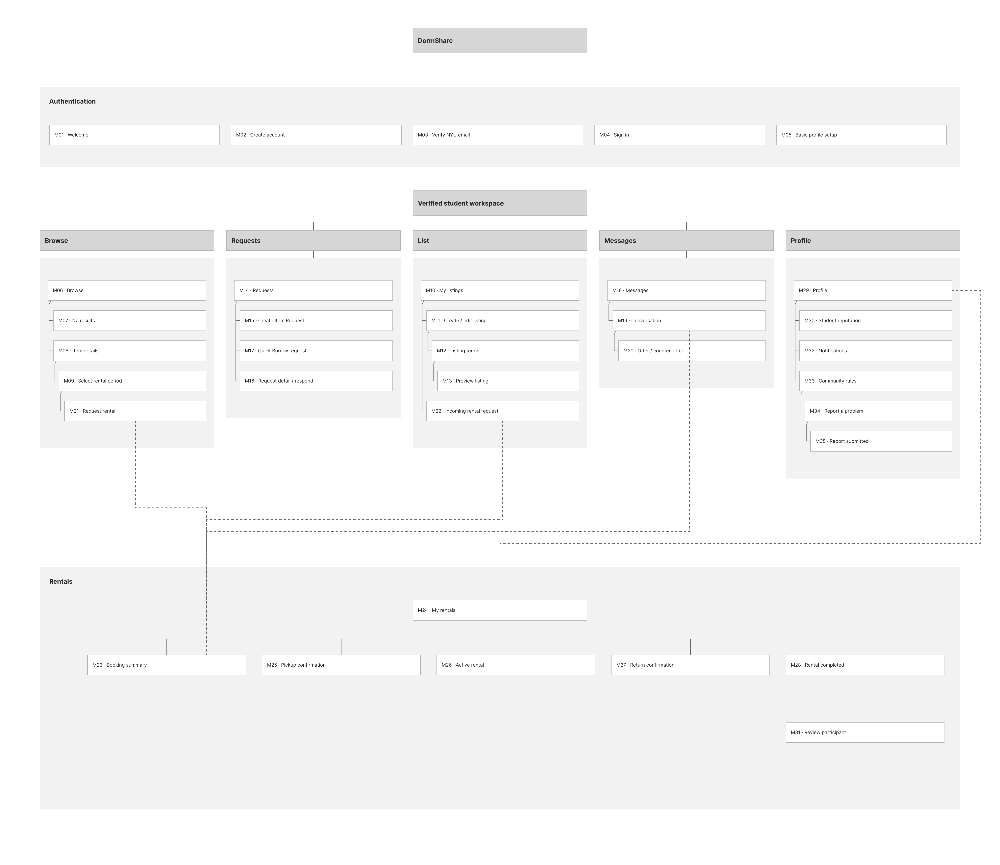
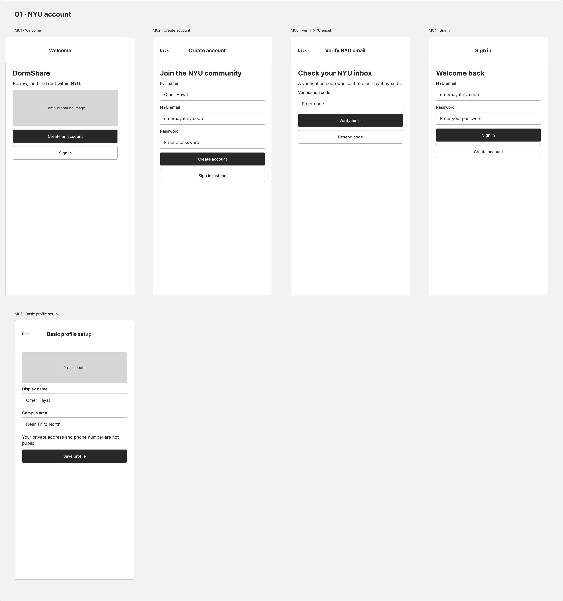
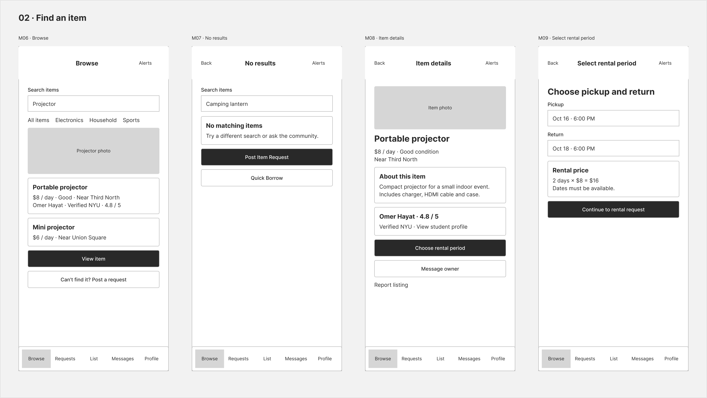
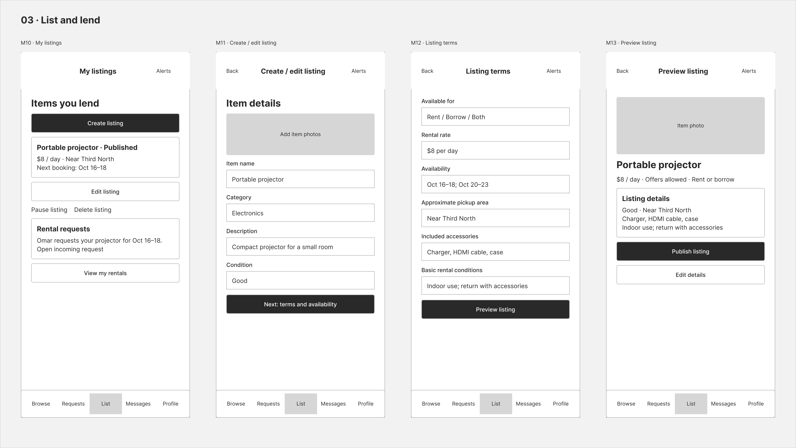
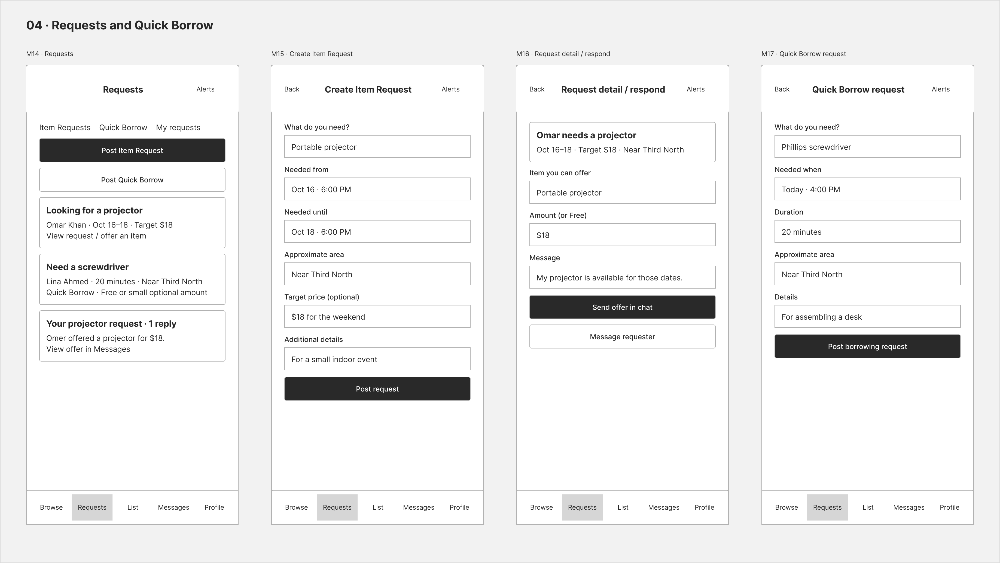
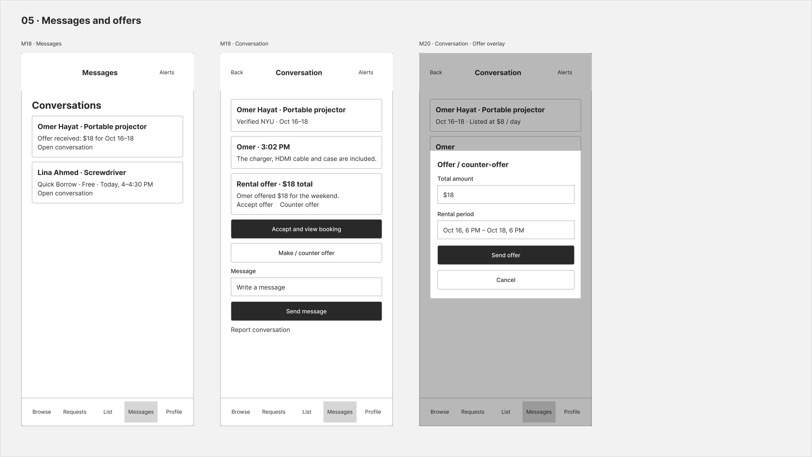
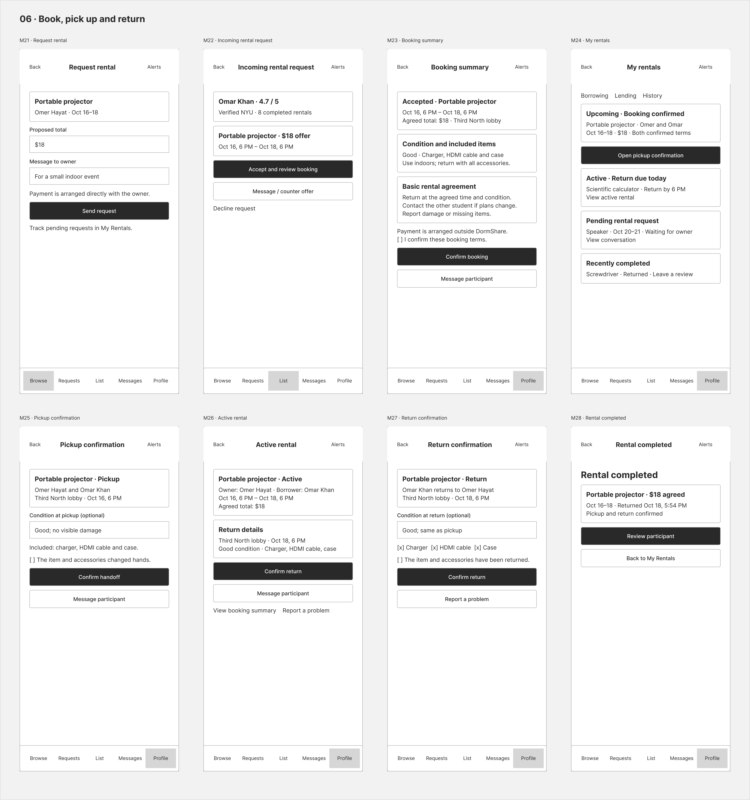
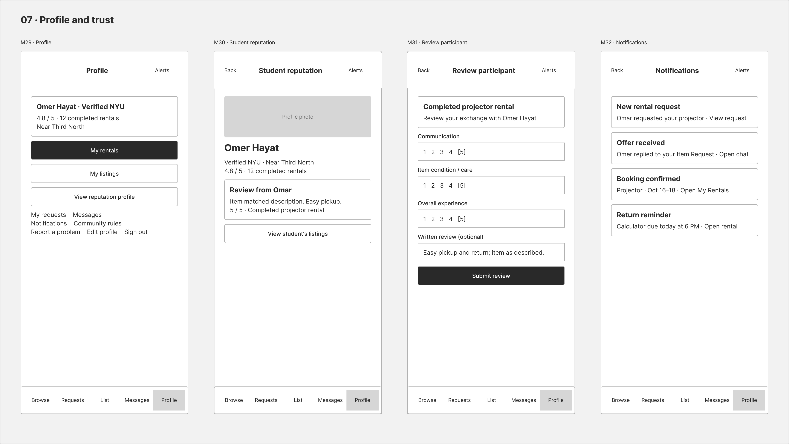
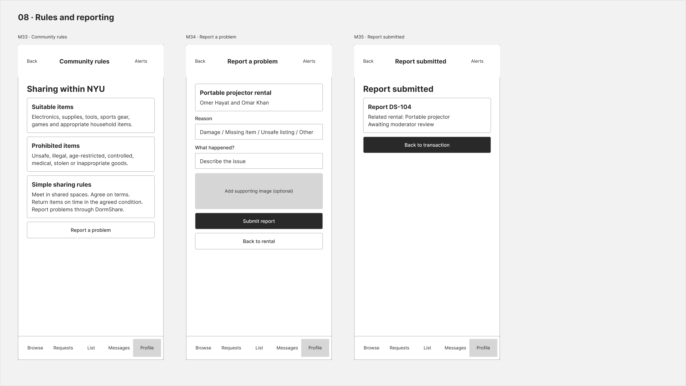

# DormShare – UX Design

**Clickable prototype (Figma):** [Open the DormShare prototype](https://www.figma.com/proto/PaibSSJTQATSMHyWcmRXvO/DormShare--Sprint-0-App-Map---Mobile-Wireframes?node-id=16-6&p=f&scaling=scale-down&content-scaling=fixed&page-id=16%3A3&starting-point-node-id=16%3A6)

The prototype starts on the Welcome screen (M01) and is sized for an iPhone 14/15 (390×844). Every screen can be reached from the start, and the bottom navigation bar (Browse, Requests, List, Messages, Profile) works on every signed-in screen. "Back" returns to the previous screen and "Alerts" opens Notifications.

Main flows to try in the prototype:

- **Sign up:** Welcome → Create account → Verify NYU email → Basic profile setup → Browse
- **Rent an item:** Browse → Item details → Select rental period → Request rental → My rentals → Pickup confirmation → Active rental → Return confirmation → Rental completed → Review participant
- **List an item:** My listings → Create / edit listing → Listing terms → Preview listing → Publish
- **Request an item and negotiate:** Requests → Request detail / respond → Conversation → Offer / counter-offer → Booking summary
- **Report a problem:** Active rental → Report a problem → Report submitted

Editable source: the Figma file [DormShare: Sprint 0 App Map & Mobile Wireframes](https://www.figma.com/design/PaibSSJTQATSMHyWcmRXvO/DormShare--Sprint-0-App-Map---Mobile-Wireframes), with a local copy in [`ux-design/dormshare-ux.fig`](ux-design/dormshare-ux.fig).

---

## App Map

The app map shows all 35 MVP screens and how they are organized. Students sign up and verify their NYU email to enter the verified student workspace. From there, the five bottom-nav sections are Browse, Requests, List, Messages and Profile. A shared Rentals section covers the full booking life cycle, from booking summary through pickup, active rental, return, completion and review.

---

## Wireframes

### 01 · NYU account

Welcome, Create account, Verify NYU email, Sign in and Basic profile setup (M01–M05). Only students with a verified NYU email can join, and private details like address and phone number stay hidden from other users.

### 02 · Find an item

Browse with search and category filters, a No results state, Item details, and Select rental period (M06–M09). The No results state points students to post an Item Request or a Quick Borrow instead.

### 03 · List and lend

My listings, Create / edit listing, Listing terms and Preview listing (M10–M13). Lenders set the price, availability, pickup area, included accessories and basic rental conditions, then preview the listing before publishing.

### 04 · Requests and Quick Borrow

The Requests board, Create Item Request, Request detail / respond, and Quick Borrow request (M14–M17). Students can post what they need, and other students can respond with an offer. Quick Borrow is for short, free or low-cost loans such as a screwdriver for 20 minutes.

### 05 · Messages and offers

The Messages list, a Conversation, and the Offer / counter-offer pop-up (M18–M20). Students negotiate inside the chat, and accepting an offer leads straight to the booking summary.

### 06 · Book, pick up and return

Request rental, Incoming rental request, Booking summary, My rentals, Pickup confirmation, Active rental, Return confirmation and Rental completed (M21–M28). Both students confirm the handoff and the return, including which accessories are included. Payment is arranged directly between the students, not in the app.

### 07 · Profile and trust

Profile, Student reputation, Review participant and Notifications (M29–M32). After each rental, both students rate each other, and those ratings build each student's public reputation.

### 08 · Rules and reporting

Community rules, Report a problem and Report submitted (M33–M35). The rules cover which items are allowed and how to share safely. A report can be filed from a listing, a conversation or a rental, and it goes to a moderator for review.
